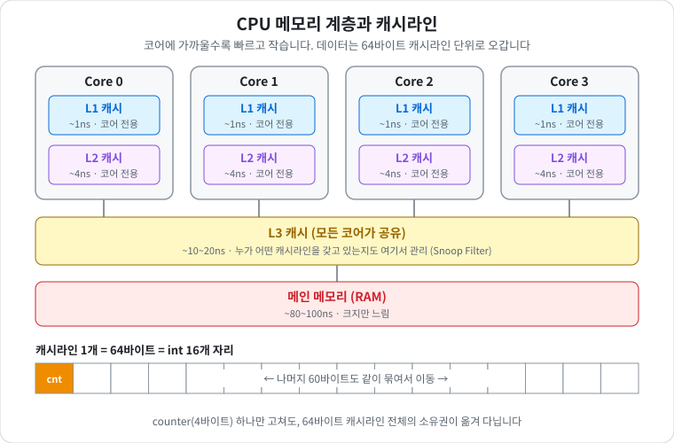
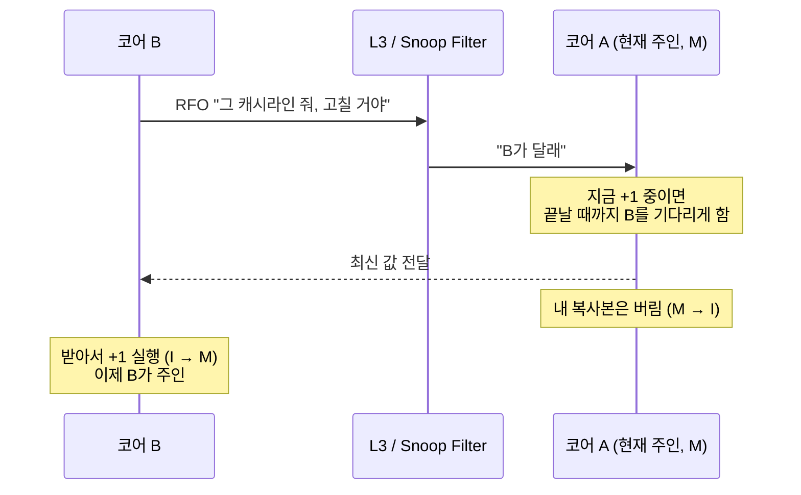
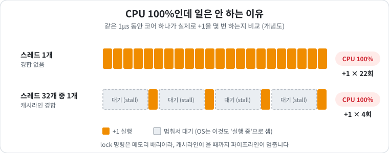
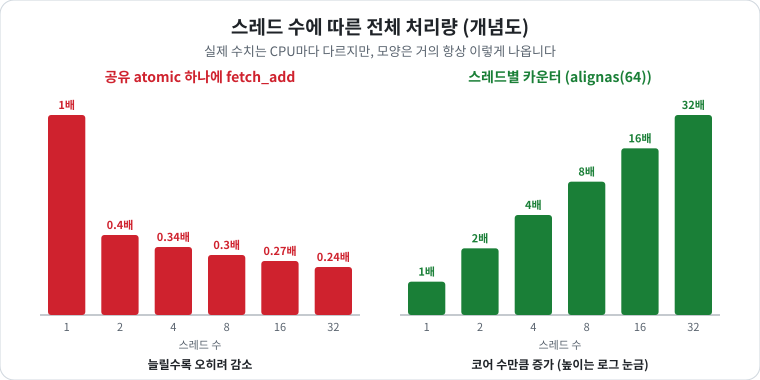
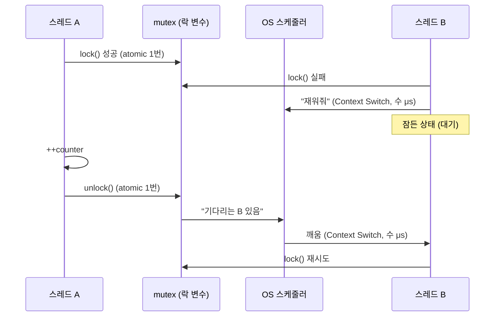
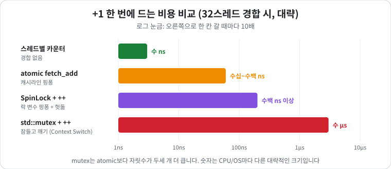

# Atomic 연산과 캐시 일관성
> 📌 기출: [NC Project NL Q5](../Interview/NC_Project_NL_%EB%A9%B4%EC%A0%91_%EC%A7%88%EB%AC%B8.md) - atomic<int32_t>에 32개 스레드가 무한히 fetch_add(1)하면 CPU에서는 어떤 일이 벌어지는가?

- **한 줄 결론**: 숫자는 정확하게 올라가지만, 32개 코어가 **숫자 하나를 서로 뺏고 넘기느라** 대부분의 시간을 기다리는 데 씁니다. 그래서 CPU는 100%인데 실제 속도는 스레드 1개일 때보다도 느려질 수 있습니다.

---

## 1. 비유로 먼저 이해하기

### 상황
- 사무실에 직원 **32명(코어)** 이 있고, 각자 **자기 책상(L1 캐시)** 이 있습니다.
- 모두가 **공용 노트 한 권(atomic 변수)** 에 적힌 숫자를 계속 +1 해야 합니다.

### 규칙
1. 숫자를 고치려면 **노트를 내 책상으로 가져와야** 합니다. (남의 책상에 있는 걸 원격으로 못 고침)
2. 내가 고치는 동안은 **아무도 노트를 못 가져갑니다.** → 그래서 숫자가 꼬이지 않음 (**원자성**)
3. 다른 사람이 달라고 하면 노트를 넘겨주고, **내 책상에 있던 복사본은 버립니다.** (옛날 값을 보면 안 되니까)

### 무슨 일이 벌어지나
```
직원 A: 노트 받음 → +1 → 넘겨줌
                          직원 B: 노트 받음 → +1 → 넘겨줌
                                                    직원 C: 노트 받음 → +1 → ...
나머지 29명: "노트 언제 와요?" (대기)
```
- 노트가 사무실을 **계속 돌아다닙니다.** (이걸 **Cache Line Ping-Pong** 이라고 부릅니다)
- **+1 하는 시간은 1초인데, 노트를 옆 책상까지 전달하는 데 10~50초** 가 걸리는 셈입니다.
- 32명 모두 "일하는 중"으로 보이지만, 실제로는 대부분 **노트를 기다리고** 있습니다. → **CPU 사용률 100%인데 일은 거의 안 함**
- 직원을 더 뽑아도 노트는 한 권이라 **빨라지지 않고**, 전달 줄만 길어져서 오히려 느려집니다.

### 움직이는 그림으로 보기

- 주황색 `counter` 블록이 캐시라인입니다. **한 순간에 한 코어만** 가질 수 있습니다.
- 가운데 패널이 파란 글씨(이동 중)인 시간이 주황 글씨(+1 완료)인 시간보다 훨씬 깁니다. → 대부분의 시간이 **이동** 에 쓰임

### 해결책도 비유로
- **각자 자기 노트에 적고, 총합이 필요할 때만 32권을 모아서 더합니다.**
- 노트를 넘길 일이 없으니 32명이 진짜로 동시에 일할 수 있습니다.


---

## 2. 용어 정리

### 기본 용어
|용어|쉬운 설명|
|---|---|
|코어 (Core)|CPU 안의 실제 일꾼. 32스레드면 보통 32개 코어(또는 하이퍼스레딩 포함)가 동시에 돎|
|캐시 (Cache)|코어 바로 옆의 작고 빠른 메모리. 책상 위 서랍 같은 것|
|L1 / L2 / L3|캐시 단계. L1이 가장 빠르고 작음(코어 전용), L3는 느리고 큼(코어들이 공유)|
|메인 메모리 (RAM)|캐시보다 훨씬 느린 큰 창고|
|캐시라인 (Cache Line)|캐시가 데이터를 옮기는 **최소 단위, 보통 64바이트**. int 하나만 필요해도 64B 덩어리째 옮김|



### Atomic 관련
|용어|쉬운 설명|
|---|---|
|원자적 (Atomic)|"중간에 끼어들 수 없는" 연산. 다 되거나, 아예 안 되거나|
|RMW (Read-Modify-Write)|읽고 → 고치고 → 쓰는 3단계. `++`이 사실 이 3단계라서 그냥 쓰면 스레드끼리 꼬임|
|`fetch_add`|RMW를 원자적으로 한 번에 해주는 함수. "더하고, 더하기 전 값을 돌려줌"|
|`lock xadd`|x86 CPU에서 `fetch_add`가 바뀌는 실제 기계어. `lock`이 "원자적으로 해라"라는 표시|
|lock-free|락(mutex) 없이 동작. 누가 멈춰도 다른 스레드는 계속 진행 가능|

### 캐시 일관성 관련
|용어|쉬운 설명|
|---|---|
|캐시 일관성 (Cache Coherence)|코어마다 캐시가 따로 있어도 **모두 같은 값을 보게** 맞춰주는 장치|
|MESI|캐시라인마다 붙는 상태표 4가지 (아래 표). 일관성을 지키는 규칙 → 자세히: [MESI_프로토콜](./MESI_%ED%94%84%EB%A1%9C%ED%86%A0%EC%BD%9C.md)|
|Invalidate (무효화)|"네가 가진 복사본은 이제 옛날 거니까 버려"|
|RFO (Read For Ownership)|"그 캐시라인 나한테 넘겨줘, 내가 고칠 거야" 요청|
|Snoop (스누프)|다른 코어들이 RFO 같은 요청을 엿듣고 반응하는 것|
|Cache Line Ping-Pong|캐시라인 하나가 코어 사이를 계속 왔다 갔다 하는 현상|
|False Sharing|**서로 다른 변수** 인데 같은 64B 캐시라인에 있어서 괜히 같이 핑퐁당하는 것|

### MESI 4가지 상태
|상태|이름|비유|
|---|---|---|
|M|Modified|노트를 나만 갖고 있고, **내가 고쳤음** (원본과 다름)|
|E|Exclusive|노트를 나만 갖고 있고, 아직 안 고쳤음|
|S|Shared|여러 명이 **읽기용 복사본** 을 갖고 있음 (고치기 금지)|
|I|Invalid|내 복사본은 **버려짐** (쓰면 안 됨)|
- **고치려면 반드시 M 또는 E 상태여야 합니다.** 즉, 나만 갖고 있어야 합니다.

### 성능 관련
|용어|쉬운 설명|
|---|---|
|메모리 배리어 (Memory Barrier)|"앞의 메모리 작업이 다 끝나기 전엔 다음으로 넘어가지 마" 라는 순서 보장 장치|
|스토어 버퍼 (Store Buffer)|코어가 쓰기를 잠깐 모아두는 임시 대기열. 배리어를 만나면 이걸 다 비워야 함|
|파이프라인 Stall|CPU가 뭔가를 기다리느라 **멈춰 서 있는** 상태|
|IPC|사이클당 처리한 명령어 수. 낮을수록 "바쁜 척만 하는 중"|
|`alignas(64)`|변수를 64바이트 경계에 맞춰 배치 → **캐시라인을 혼자 쓰게** 만듦|
|`memory_order_relaxed`|"순서는 상관없고 값만 정확하면 돼" 라는 가장 느슨한 옵션|

---

## 3. 실제로 CPU에서 일어나는 일 (단계별)

### Step 1. `fetch_add`가 기계어로 바뀜
```cpp
counter.fetch_add(1);
```
- x86에서는 `lock xadd` **명령어 하나** 가 됩니다.
- 이 명령어는 **실패하거나 재시도하는 일이 없습니다.** 문제는 오직 "캐시라인을 받아오는 시간"입니다.

### Step 2. 고치려면 캐시라인을 독점해야 함
- 값을 고치려면 그 캐시라인을 **M 상태(나만 소유)** 로 가져와야 합니다.
- 다른 코어가 갖고 있으면 **RFO** 요청을 보내 달라고 합니다.

### Step 3. 다른 코어는 넘겨주고 자기 것은 버림

- 이게 **+1 한 번마다** 반복됩니다.
- **A가 +1 하는 동안 B의 요청을 기다리게 하는 것**, 이것이 원자성이 지켜지는 원리입니다.

### Step 4. 기다리는 시간이 대부분
|상황|+1 한 번 걸리는 시간 (대략)|
|---|---|
|라인이 이미 내 L1에 있음 (경합 없음)|수 ns|
|다른 코어에서 받아와야 함|수십 ns|
|다른 CPU 소켓에서 받아와야 함 (서버용 2소켓 등)|100 ~ 수백 ns|
- **같은 +1인데 10~100배 느려집니다.**
- 위의 [메모리 계층 그림](#기본-용어)에서 L1 → L3 → 다른 코어로 가는 거리만큼 느려진다고 보면 됩니다.

### Step 5. 코어는 멈춰서 기다림
- `lock` 명령은 **메모리 배리어** 역할도 합니다.
- 그래서 코어는 "앞에서 쓰던 것 다 정리하고(스토어 버퍼 비우기), 캐시라인 올 때까지" **멈춰 섭니다 (stall).**
- OS는 스레드가 실행 중이라 **CPU 100%** 로 표시하지만, 실제로는 대부분 기다리는 중입니다.



### Step 6. 스레드를 늘려도 안 빨라짐


- **1개**: 캐시라인이 계속 내 L1에 있어서 가장 빠름
- **2개 이상**: 매번 넘겨받아야 해서 **전체가 오히려 느려짐**
- **더 늘리면**: 노트는 한 권이라 그대로이거나, 대기 줄이 길어져 더 느려짐

---

## 4. 같이 생기는 부수 문제
1. **다른 작업까지 느려짐**
    - 캐시라인을 넘기는 메시지가 CPU 내부 통로를 꽉 채워서, **이 카운터와 상관없는 스레드도 느려집니다.**
2. **False Sharing**
    - 같은 64B 안에 다른 변수가 같이 있으면, 그 변수를 **읽기만 하는 스레드도** 계속 캐시 미스를 맞습니다.
    - 서로 다른 변수를 각자 쓰기만 해도 캐시라인이 통째로 핑퐁합니다.

    
3. **불공정**
    - CPU는 "공평하게 돌아가며" 주지 않습니다. 어떤 스레드는 많이, 어떤 스레드는 적게 증가시킵니다.
4. **오버플로우가 금방 옴**
    - `int32_t` 최대값은 약 21억입니다. 초당 수천만 번 증가하면 **수십 초~몇 분이면** 넘칩니다.
    - atomic은 넘쳐도 프로그램이 터지진 않고(정의된 동작) **음수로 감기지만**, 로직상 버그입니다. → `int64_t` 사용

### 그래도 mutex보다는 낫다
- 락이 없어서 **Context Switching이 없고**, 스레드 하나가 OS에 의해 멈춰도 다른 스레드는 계속 진행합니다 (lock-free).
- 즉, "mutex보다는 빠르지만, 코어를 늘린다고 빨라지지는 않는다"가 정확한 표현입니다.

---

## 5. lock을 쓰면 더 빠를까?
- **아니요, 더 느립니다.** lock은 atomic의 비용을 그대로 안고, 거기에 비용이 더 붙는 구조입니다.

### 이유 1. lock 자체가 atomic으로 만들어져 있음
- `std::mutex`의 내부는 "잠김/풀림"을 나타내는 변수 하나이고, 이 변수를 바꿀 때 **atomic 연산(`lock cmpxchg`)** 을 씁니다.

```cpp
mtx.lock();     // 내부적으로 atomic 연산 1번 (락 변수에 쓰기)
++counter;      // 카운터에 쓰기
mtx.unlock();   // 내부적으로 atomic 연산 1번 더
```
- 32개 스레드가 lock을 잡으면 **락 변수의 캐시라인이 똑같이 핑퐁** 하고, 카운터의 캐시라인까지 같이 옮겨 다닙니다.
- 핑퐁이 없어지는 게 아니라 **오히려 늘어납니다.**

### 이유 2. 기다리는 스레드는 잠듦
- atomic은 기다려도 코어 위에서 하드웨어 수준으로 잠깐 기다립니다.
- mutex는 차례가 아니면 OS에 "재워줘"라고 하고, 락이 풀리면 OS가 다시 깨웁니다. 이게 **Context Switching** 이고, 한 번에 **수 μs** 가 걸립니다. ([Context_Switching](./Context_Switching.md))
- atomic 경합 비용(수십 ns)과 **자릿수가 두세 개** 다릅니다.


- `++counter` 한 번을 위해 atomic 2번 + 잠들기/깨기 2번이 들어갑니다.

### 비유로 보면
- **atomic**: 노트를 받아서 바로 +1 하고 넘김
- **mutex**: 노트 옆에 **열쇠함** 이 있어서, 먼저 **열쇠를 받아와야** 노트를 만질 수 있음
    - 열쇠도 사람들 사이를 돌아다님 → 핑퐁이 하나 더 생김
    - 열쇠가 없으면 **집에 가서 자다가 전화 받고 다시 출근** 함 → Context Switching

### 대략적인 비교 (1회 기준)
|방식|경합 없을 때|32스레드 경합 시|
|---|---|---|
|스레드별 카운터|수 ns|수 ns (경합 없음)|
|`atomic fetch_add`|수 ns|수십 ~ 수백 ns|
|SpinLock + `++`|수십 ns|atomic보다 나쁨 (락 변수 핑퐁 + 헛도는 시도)|
|`std::mutex` + `++`|수십 ns|**수 μs** (잠들고 깨는 비용)|
- 숫자는 CPU/OS에 따라 다른 대략적인 크기지만, **순서는 거의 항상 이렇습니다.**



### 그럼 lock은 언제 쓰나
- "빠르냐 느리냐"보다 **용도가 다릅니다.**
    - **atomic**: **변수 하나** 만 안전하게 바꿀 수 있음
    - **lock**: **여러 변수를 한 묶음으로** 바꿀 때 필요

```cpp
// 골드 차감과 아이템 지급이 "같이" 일어나야 할 때
std::lock_guard<std::mutex> guard(mtx);
if (gold >= price) {
    gold -= price;
    inventory.push_back(item);   // vector 같은 복잡한 자료구조도 보호
}
```
- atomic 두 개로 나누면 `gold`는 빠졌는데 아이템은 아직 안 들어간 순간을 다른 스레드가 볼 수 있습니다.
- 이렇게 **여러 값이 항상 맞아떨어져야 할 때 (불변식)** 는 lock이 정답입니다.

### lock이 이득처럼 보이는 경우
- 한 번 잡고 **여러 개를 몰아서 처리** 하면 비용이 나뉘어 괜찮아집니다.

```cpp
std::lock_guard<std::mutex> guard(mtx);
for (int i = 0; i < 1000; ++i) ++counter;   // 락 1번에 1000번 증가
```
- 다만 lock이 빨라서가 아니라 **배칭** 덕분입니다. 같은 원리로 스레드 로컬 변수에 1000번 더하고 atomic으로 한 번만 더하는 게 더 빠릅니다.

### 면접 답변
> "mutex는 내부적으로 atomic으로 구현되어 있어서 락 변수 자체가 핑퐁하고, 경합 시 Context Switching까지 일어나기 때문에 단일 카운터에서는 atomic보다 느립니다. 다만 atomic은 변수 하나만 보호할 수 있어서, 여러 값을 함께 바꿔야 하는 경우에는 lock이 필요합니다. 카운터처럼 단순한 경우라면 lock도 atomic도 아닌 스레드별 카운터가 가장 빠릅니다."

---

## 6. 해결 방법
### 방식별 비교
|방식|비유|확장성|
|---|---|---|
|`mutex` + `++`|노트 앞에 줄 서고, 차례 아니면 잠자러 감|가장 나쁨|
|CAS 루프|노트 받아서 고치려는데 그새 누가 바꿨으면 처음부터 다시|나쁨|
|`fetch_add`|노트 받으면 무조건 한 번에 성공|공유 변수 중엔 최선, 그래도 안 늘어남|
|**스레드별 카운터 + 합산**|**각자 자기 노트에 적고 필요할 때만 합침**|**코어 수만큼 빨라짐**|

### 스레드별 카운터 코드
```cpp
struct alignas(64) PaddedCounter {      // 64B 맞춤 → 캐시라인 혼자 사용
    std::atomic<int64_t> v{0};          // int64로 오버플로우 방지
};
PaddedCounter local[32];                // 스레드마다 자기 노트

void Inc(int tid) {
    local[tid].v.fetch_add(1, std::memory_order_relaxed);
}

int64_t Total() {                       // 총합이 필요할 때만 모아서 더함
    int64_t s = 0;
    for (auto& c : local) s += c.v.load(std::memory_order_relaxed);
    return s;
}
```
- 핵심은 **`alignas(64)`로 캐시라인을 나눈 것** 입니다. 노트를 넘길 일이 없으니 L1 안에서 바로 끝납니다.
- 더 줄이고 싶으면 일반 지역 변수에 모았다가 **N번에 한 번만** 공유 카운터에 더합니다 (배칭).

---

## 7. 면접 답변
### 쉬운 버전 (말로 풀기)
> "값은 정확하게 올라갑니다. 다만 값을 고치려면 그 캐시라인을 내 코어가 혼자 가져와야 해서, 32개 코어가 캐시라인 하나를 계속 주고받게 됩니다. +1 자체보다 캐시라인을 넘겨받는 시간이 훨씬 길어서, CPU는 100%인데 대부분 기다리기만 하고 스레드를 늘려도 빨라지지 않습니다. 그래서 스레드마다 캐시라인을 분리한 카운터를 두고, 필요할 때만 합산하는 방식으로 해결합니다."

### 키워드 넣은 버전
> "`lock xadd` 한 명령으로 처리되기 때문에 값은 정확합니다. 다만 쓰기를 하려면 캐시라인을 MESI의 Modified 상태로 독점해야 해서, 32개 코어가 라인 하나를 번갈아 가져가는 Ping-Pong이 일어납니다. 연산 하나가 L1 지연이 아니라 코어 간 전송 지연이 되고, lock 명령은 풀 배리어라 파이프라인도 멈춥니다. 그래서 CPU는 100%인데 전체 처리량은 스레드 수와 상관없이 일정하거나 오히려 떨어집니다. 해결책은 `alignas(64)`로 분리한 스레드별 카운터를 두고 읽을 때 합산하는 것이고, int32는 이 속도면 금방 오버플로우가 나니 64비트를 써야 합니다."

---

## 8. 심화 (꼬리 질문 대비)
> 수치는 CPU 세대와 구성에 따라 달라지는 대략적인 크기입니다.

### 아키텍처별 차이
|아키텍처|명령어|특징|
|---|---|---|
|x86-64|`lock xadd`|한 번에 성공, 재시도 없음|
|ARMv8.1+ (LSE)|`ldaddal`|한 번에 성공. L3나 원격에서 대신 실행되기도 함 (far atomic)|
|ARMv8.0|`ldaxr` / `stlxr` 루프|다른 코어가 끼어들면 실패 후 재시도 → 경합 시 재시도 폭증|

### Split Lock
- 변수가 **두 캐시라인에 걸쳐 있으면** 캐시라인 하나만 잠글 수 없어서 **메모리 버스 전체를 잠급니다.**
- 모든 코어의 메모리 접근이 멈추는 수준이라, 최근 Intel/Linux는 감지해서 경고/차단합니다.
- `std::atomic`은 자동 정렬이라 안전하지만, `#pragma pack` 구조체 안의 값을 `InterlockedIncrement`로 다루면 발생할 수 있습니다. ([메모리_얼라인먼트](./%EB%A9%94%EB%AA%A8%EB%A6%AC_%EC%96%BC%EB%9D%BC%EC%9D%B8%EB%A8%BC%ED%8A%B8.md))

### 하드웨어 구조에 따른 차이
- **멀티소켓 서버**: CPU 칩이 2개 이상이면 칩 사이 통로가 느려서 핑퐁 비용이 훨씬 커집니다.
- **AMD CCX**: 코어가 묶음(CCX) 단위로 L3를 공유해서, 같은 묶음 안은 싸고 묶음 밖은 비쌉니다.
- **하이퍼스레딩 (SMT)**: 같은 물리 코어의 두 스레드는 L1을 공유해서 넘기는 비용은 싸지만, 실행 자원을 나눠 써서 큰 이득은 없습니다.
- **프로토콜 변형**: Intel은 MESIF, AMD는 MOESI를 씁니다. 기본 원리는 MESI와 같습니다.

### 측정 방법
- **Linux**: `perf c2c record` / `perf c2c report` → 다른 코어의 Modified 라인을 가져온 횟수(**HITM**)가 어느 변수/코드에서 많은지 확인
- **Windows**: Intel VTune의 Memory Access 분석
- **간단 실험**: 스레드 수를 1, 2, 4, 8, 16, 32로 바꿔가며 1초 동안 총 증가 횟수를 찍어보면 Step 6 그래프가 재현됩니다.

- 관련 문서: [멀티스레드를_쓰는_이유](./%EB%A9%80%ED%8B%B0%EC%8A%A4%EB%A0%88%EB%93%9C%EB%A5%BC_%EC%93%B0%EB%8A%94_%EC%9D%B4%EC%9C%A0.md), [MESI_프로토콜](./MESI_%ED%94%84%EB%A1%9C%ED%86%A0%EC%BD%9C.md), [메모리_얼라인먼트](./%EB%A9%94%EB%AA%A8%EB%A6%AC_%EC%96%BC%EB%9D%BC%EC%9D%B8%EB%A8%BC%ED%8A%B8.md), [멀티스레드_메모리_할당](./%EB%A9%80%ED%8B%B0%EC%8A%A4%EB%A0%88%EB%93%9C_%EB%A9%94%EB%AA%A8%EB%A6%AC_%ED%95%A0%EB%8B%B9.md), [Context_Switching](./Context_Switching.md)
