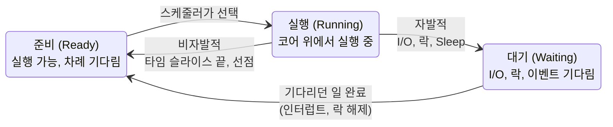

# Context Switching
> 📌 기출: [NC Project NL Q3](../Interview/NC_Project_NL_%EB%A9%B4%EC%A0%91_%EC%A7%88%EB%AC%B8.md) - Context Switching은 언제 발생하는가? 아는 만큼 설명해달라.

- **한 줄 결론**: CPU 코어 하나가 **하던 일을 잠깐 멈추고, 상태를 저장한 뒤, 다른 스레드의 일을 이어서 하는 것**입니다. 스레드가 스스로 기다릴 때(자발적), 또는 OS가 강제로 바꿀 때(비자발적) 발생합니다.

---

## 1. 비유로 먼저 이해하기

### 상황
- 주방에 **요리사 한 명(코어)** 이 있고, 동시에 들어온 **주문 여러 개(스레드)** 를 처리해야 합니다.
- 요리사는 한 번에 한 요리만 할 수 있어서, 요리를 **번갈아 가며** 만듭니다.

### 요리를 바꿀 때마다 해야 하는 일
1. **지금 요리 상태를 메모** 합니다. "파스타: 면 삶는 중, 소스 절반 완성, 다음은 마늘 볶기"
    - → CPU가 **레지스터, 다음 실행 위치(PC), 스택 위치** 를 저장하는 것
2. **다음 요리의 메모를 꺼내서** 이어서 합니다. "스테이크: 굽기 3분 남음"
    - → 다른 스레드의 저장된 상태를 **복원** 하는 것
3. **도마 위 재료를 치우고, 다음 요리 재료를 다시 꺼냅니다.**
    - → 캐시에 있던 데이터가 쓸모없어지고 새 데이터를 다시 가져오는 것 (**캐시 오염**)

### 핵심 포인트
- 메모하고 꺼내는 시간에는 **요리가 하나도 진행되지 않습니다.** → 순수한 **오버헤드**
- 사실 **재료를 다시 꺼내는 시간(캐시)** 이 메모 시간보다 더 큽니다.
- 너무 자주 바꾸면 요리사는 바쁜데 **완성되는 요리가 줄어듭니다.**

---

## 2. 용어 정리
|용어|쉬운 설명|
|---|---|
|Context (문맥)|스레드가 "어디까지 했는지"를 담은 상태 정보. 레지스터 값, 다음 실행할 위치, 스택 위치 등|
|레지스터 (Register)|CPU 코어 안의 가장 빠른 작업 공간. 요리사의 손에 들고 있는 재료|
|PC (Program Counter)|다음에 실행할 명령어 위치. 레시피에서 "몇 번째 단계까지 했는지"|
|PCB / TCB|OS가 프로세스/스레드마다 Context를 저장해두는 공간. 요리별 메모지|
|스케줄러 (Scheduler)|다음에 어떤 스레드를 실행할지 정하는 OS의 관리자. 주방 매니저|
|타임 슬라이스 (Quantum)|스레드 하나가 한 번에 쓸 수 있는 CPU 시간. 보통 수 ms ~ 수십 ms|
|선점 (Preemption)|OS가 실행 중인 스레드를 **강제로** 멈추고 다른 스레드에게 넘기는 것|
|커널 모드 / 유저 모드|OS만 할 수 있는 일(커널)과 일반 프로그램이 하는 일(유저)을 나눈 CPU 실행 모드|
|캐시 오염|전환 후 새 스레드가 쓸 데이터가 캐시에 없어 처음에 느린 현상|
|TLB|가상 주소 → 물리 주소 변환 결과를 저장해두는 캐시. 주방 안 "재료 위치 지도"|

---

## 3. 언제 발생하나
### 스레드 상태로 보기
- 스레드는 아래 3가지 상태를 오갑니다. **Running에서 빠져나가는 화살표가 곧 Context Switching** 입니다.

### 1) 자발적 전환 (Voluntary): 스레드가 스스로 CPU를 내놓음
|상황|비유|예시|
|---|---|---|
|I/O 대기|오븐에 넣고 20분 기다려야 하니 다른 요리부터|`recv()`, DB 쿼리 응답 대기, 파일 읽기|
|락 대기|필요한 냄비를 다른 요리사가 쓰는 중이라 기다림|`mutex.lock()`, `WaitForSingleObject`|
|조건 대기|주문이 들어올 때까지 쉼|`condition_variable.wait()`, 빈 작업 큐 대기|
|직접 양보|"지금 할 거 없으니 다른 거 먼저 하세요"|`Sleep()`, `std::this_thread::yield()`|

### 2) 비자발적 전환 (Involuntary): OS가 강제로 바꿈
|상황|비유|예시|
|---|---|---|
|타임 슬라이스 소진|매니저: "그 요리 오래 했으니 다른 것 좀 해"|무한 루프 계산 스레드도 일정 시간 후 교체|
|높은 우선순위 등장|VIP 주문이 들어와서 하던 요리를 잠깐 내려놓음|우선순위 높은 스레드가 깨어남|
|인터럽트 처리 후|전화 받고 돌아왔더니 매니저가 다른 요리를 먼저 하라고 함|네트워크 패킷 도착, 타이머 인터럽트 후 스케줄러 재호출|

### 예시로 따라가기

- 주황색 세로선이 시간을 따라 움직이며, 아래 상자에 지금 무슨 일이 일어나는지 설명이 바뀝니다.

> 코어 1개, 스레드 A(DB 저장), B(게임 로직)

|순서|일어난 일|전환 종류|
|---|---|---|
|1|A가 DB에 쿼리를 보내고 응답을 기다림|**자발적** (I/O 대기) → B로 전환|
|2|B가 게임 로직을 계속 계산함|-|
|3|B의 타임 슬라이스가 끝남, A는 아직 응답 대기 중|전환할 대상이 없어 B가 계속 실행|
|4|DB 응답 도착 (인터럽트) → A가 실행 가능 상태가 됨|-|
|5|B의 타임 슬라이스가 끝남|**비자발적** → A로 전환|
|6|A가 응답을 처리하고, 다음 저장을 위해 락을 잡으려는데 다른 스레드가 쥐고 있음|**자발적** (락 대기) → B로 전환|

---

## 4. 왜 비싼가 (비용)

### 직접 비용: 메모하고 꺼내는 시간
- 레지스터 저장/복원
- 유저 모드 → 커널 모드 → 유저 모드 전환
- 스케줄러가 다음 스레드를 고르는 시간
- 대략 **수 μs** 수준

### 간접 비용: 재료를 다시 꺼내는 시간 (실제로 더 큼)
- 새 스레드가 쓸 데이터가 캐시에 없어서 **처음 한동안 캐시 미스** 가 납니다.
- CPU의 **분기 예측** 정보도 이전 스레드 기준이라 틀리기 쉽습니다.
- 전환 직후 한동안 느린 상태가 이어집니다.

### 스레드 전환 vs 프로세스 전환
> 비유: **같은 주방에서 요리만 바꾸기** vs **다른 식당 주방으로 이동하기**

|구분|스레드 전환 (같은 프로세스)|프로세스 전환|
|---|---|---|
|비유|같은 주방, 재료 위치 그대로|다른 식당 주방, 재료 위치 지도부터 새로 익혀야 함|
|레지스터 저장/복원|O|O|
|주소 공간 교체|X (메모리를 공유)|O (페이지 테이블 교체, CR3 레지스터 변경)|
|TLB|유지|**비워짐** (PCID 지원 시 완화)|
|비용|상대적으로 낮음|높음|
- 프로세스 전환이 비싼 이유는 **"재료 위치 지도(TLB)"를 버리고 새로 만들어야** 하기 때문입니다. ([가상_메모리](./%EA%B0%80%EC%83%81_%EB%A9%94%EB%AA%A8%EB%A6%AC.md))

### 헷갈리기 쉬운 것: 시스템 콜 ≠ Context Switching
- 시스템 콜(`send()`, `ReadFile()` 등)은 **유저 → 커널 모드 전환** 이지만, 같은 스레드가 계속 실행되면 Context Switching이 아닙니다.
- 시스템 콜 안에서 **기다려야 해서 다른 스레드로 넘어갈 때** 비로소 Context Switching이 일어납니다.
- 비유: 요리사가 창고에 재료를 가지러 가는 건(모드 전환) 요리를 바꾸는 게 아님. 창고에 재료가 없어서 **다른 요리부터 시작하면** 그게 전환.

---

## 5. 서버 개발 관점: 언제 문제가 되나
### 스레드가 코어보다 너무 많을 때
- 요리사 8명(코어)에 주문 200개(스레드)를 동시에 맡기면, 매니저가 계속 요리를 바꾸라고 시킵니다.
- 전환이 급증하고 캐시가 계속 오염되어 **전체 처리량이 떨어집니다.**
- → IOCP 워커 스레드 수를 **코어 수 근처** 로 맞추는 이유

### 락 경합이 심할 때
- 냄비 하나를 여러 요리사가 쓰려고 하면, 기다리는 요리사들이 계속 "잠들었다 깨기"를 반복합니다.
- mutex 대기 1번 = Context Switching 최대 2번 (잠들 때, 깰 때)
- → [Atomic과_캐시_일관성](./Atomic%EA%B3%BC_%EC%BA%90%EC%8B%9C_%EC%9D%BC%EA%B4%80%EC%84%B1.md)의 "lock을 쓰면 더 빠를까?" 참고

### 짧게 기다릴 때 vs 길게 기다릴 때
|대기 시간|선택|비유|
|---|---|---|
|아주 짧음 (수십 ns ~ 수 μs)|**SpinLock**: 잠들지 않고 계속 확인|냄비가 곧 빌 것 같으면 옆에서 서서 기다림|
|긺 (I/O, 긴 임계 영역)|**mutex / 이벤트**: 잠들었다가 깨움|오래 걸리면 다른 일 하다가 불러달라고 함|
- 잠들고 깨는 비용(수 μs)보다 **기다리는 시간이 짧으면 스핀**, 길면 잠드는 게 낫습니다.
- Windows의 `SRWLock`, `CRITICAL_SECTION`(스핀 카운트)은 **잠깐 스핀하다가 안 되면 잠드는** 방식으로 둘을 섞습니다.

---

## 6. 줄이는 방법
1. **스레드 수를 코어 수에 맞추기**: 워커 스레드를 무작정 늘리지 않습니다.
2. **블로킹 I/O 대신 비동기 I/O**: IOCP처럼 "끝나면 알려줘" 방식으로 스레드가 잠들 일을 줄입니다.
3. **락 범위 줄이기 / 공유 줄이기**: 락을 짧게 잡고, 가능하면 데이터를 스레드별로 나눠 락 자체를 없앱니다. ([멀티스레드를_쓰는_이유](./%EB%A9%80%ED%8B%B0%EC%8A%A4%EB%A0%88%EB%93%9C%EB%A5%BC_%EC%93%B0%EB%8A%94_%EC%9D%B4%EC%9C%A0.md))
4. **짧은 임계 영역은 스핀 계열 락**: SpinLock, SRWLock
5. **`Sleep(1)` 남발 주의**: 바쁜 대기를 피하려고 `Sleep`을 넣으면 매번 전환이 생깁니다. ([Sleep(0) vs Sleep(1) 차이](../Etc/Sleep(0)_vs_Sleep(1)_%EC%B0%A8%EC%9D%B4.md))

---

## 7. 면접 답변
### 쉬운 버전
> "코어 하나가 여러 스레드를 번갈아 실행하기 위해, 지금 스레드의 상태를 저장하고 다른 스레드의 상태를 불러오는 것입니다. 스레드가 I/O나 락을 기다리면서 스스로 CPU를 내놓을 때, 또는 타임 슬라이스가 끝나거나 우선순위가 높은 스레드가 깨어나서 OS가 강제로 바꿀 때 발생합니다. 저장/복원 자체보다 캐시가 식는 비용이 커서, 너무 잦으면 성능이 떨어집니다."

### 키워드 넣은 버전
> "Context Switching은 레지스터, PC, 스택 포인터 같은 실행 문맥을 TCB에 저장하고 다른 스레드의 문맥을 복원하는 과정입니다. 블로킹 I/O, 락 대기, Sleep/yield 같은 자발적 전환과, 타임 슬라이스 소진, 선점, 인터럽트 후 재스케줄링 같은 비자발적 전환이 있습니다. 비용은 커널 모드 전환과 문맥 저장/복원의 직접 비용, 캐시와 분기 예측이 오염되는 간접 비용이 있고, 프로세스 간 전환은 페이지 테이블이 바뀌어 TLB까지 비워지므로 더 비쌉니다. 그래서 서버에서는 워커 스레드를 코어 수에 맞추고, 비동기 I/O와 짧은 스핀 락으로 불필요한 전환을 줄입니다."

---

## 8. 심화 (꼬리 질문 대비)
> 수치는 OS와 CPU에 따라 다른 대략적인 크기입니다.

### 유저 모드 전환: 코루틴 / 파이버
- OS를 거치지 않고 **프로그램이 직접** 실행 흐름을 바꾸는 방식입니다. (C++20 코루틴, Windows Fiber, 그린 스레드)
- 커널 모드 전환이 없어 훨씬 싸지만, 블로킹 시스템 콜을 부르면 그 OS 스레드 전체가 멈춥니다.
- 비유: 매니저(OS)를 부르지 않고 요리사가 **스스로 메모지를 바꿔 드는 것**

### 측정 방법
|환경|도구|보는 값|
|---|---|---|
|Windows|성능 모니터 (perfmon)|`System\Context Switches/sec`, 스레드별 `Context Switches/sec`|
|Windows|WPA / ETW|어떤 스레드가 왜 깨어났는지 (ReadyThread, CSwitch 이벤트)|
|Linux|`vmstat 1`|`cs` 열 (초당 전환 수)|
|Linux|`pidstat -w`|`cswch/s`(자발적), `nvcswch/s`(비자발적)|
- **자발적 전환이 많으면** → 락 경합이나 I/O 대기를 의심
- **비자발적 전환이 많으면** → 스레드가 코어보다 많거나 CPU를 오래 쓰는 스레드가 있는지 의심

- 관련 문서: [가상_메모리](./%EA%B0%80%EC%83%81_%EB%A9%94%EB%AA%A8%EB%A6%AC.md), [멀티스레드를_쓰는_이유](./%EB%A9%80%ED%8B%B0%EC%8A%A4%EB%A0%88%EB%93%9C%EB%A5%BC_%EC%93%B0%EB%8A%94_%EC%9D%B4%EC%9C%A0.md), [Atomic과_캐시_일관성](./Atomic%EA%B3%BC_%EC%BA%90%EC%8B%9C_%EC%9D%BC%EA%B4%80%EC%84%B1.md), [Sleep(0) vs Sleep(1) 차이](../Etc/Sleep(0)_vs_Sleep(1)_%EC%B0%A8%EC%9D%B4.md)
