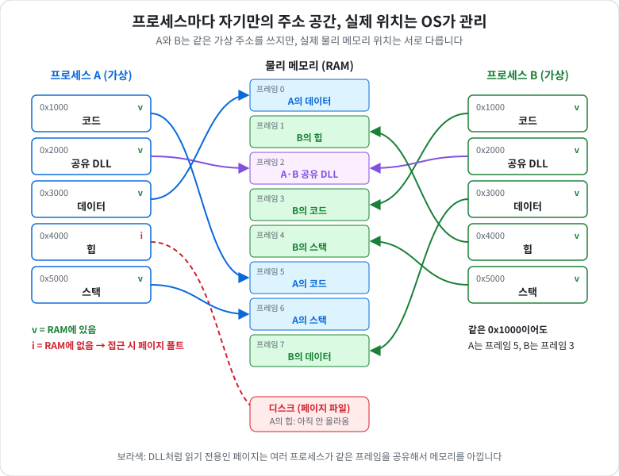
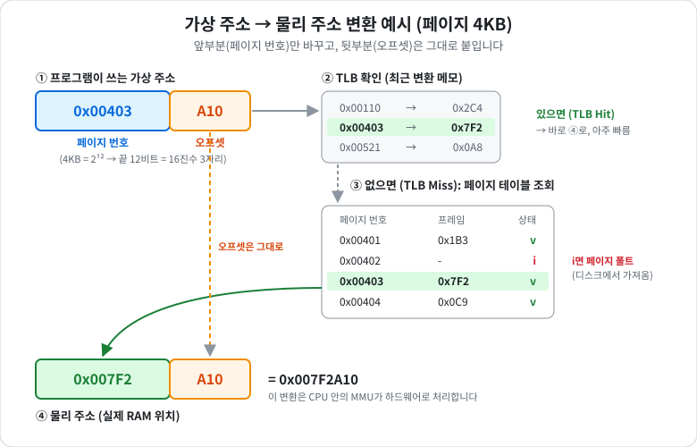
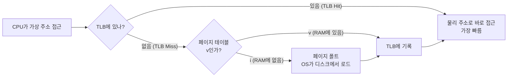
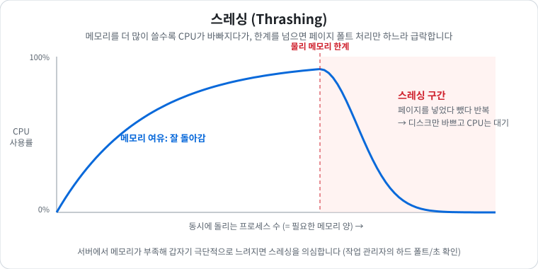
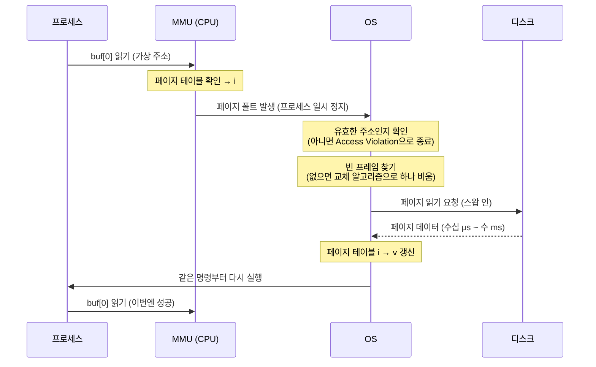
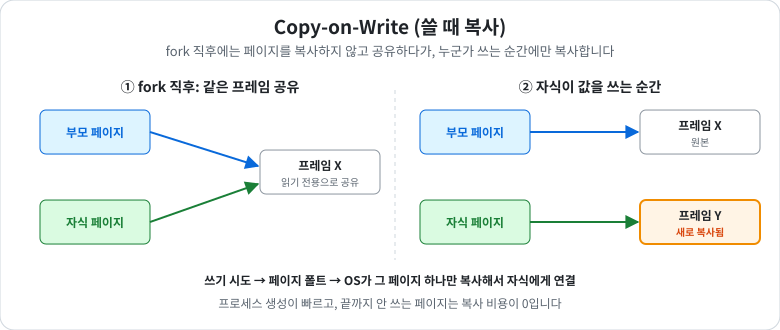

# 가상 메모리
> 📌 기출: [NC Project NL Q4](../Interview/NC_Project_NL_%EB%A9%B4%EC%A0%91_%EC%A7%88%EB%AC%B8.md) - Virtual Memory

- 프로세스의 일부만 메모리에 로드하고, 나머지는 디스크에 둔 상태로 프로세스를 실행하는 방식
- 물리적 메모리(RAM)가 제한적인 경우에도 더 큰 프로그램을 실행할 수 있게 됩니다.
- **한 줄 결론**: 프로세스마다 "나만 쓰는 넓은 주소 공간"을 착각하게 해주고, 실제 RAM 위치는 OS와 CPU(MMU)가 **페이지 단위로 몰래 연결** 해주는 기법입니다.

---

## 1. 비유로 먼저 이해하기

### 상황: 호텔
- 손님(**프로세스**)마다 "이 호텔은 나 혼자 쓴다"고 생각하고, 방 번호를 **1번부터 마음대로** 씁니다. (**가상 주소**)
- 실제 방(**물리 메모리 프레임**)은 한정되어 있어서, 손님 A의 "1번 방"과 손님 B의 "1번 방"은 **실제로는 다른 방** 입니다.

### 누가 연결해주나
- **프런트(MMU)** 가 **장부(페이지 테이블)** 를 보고 "A의 1번 방 = 실제 503호"로 안내합니다.
- 프런트는 자주 찾는 방을 **메모지(TLB)** 에 적어두고, 장부를 펼치지 않고 바로 안내합니다.

### 방이 모자라면
- 당장 안 쓰는 짐은 **창고(디스크)** 에 보관합니다.
- 손님이 창고에 있는 짐을 찾으면, 프런트가 창고에서 가져와 방에 넣어줍니다. 이게 **페이지 폴트** 입니다. (시간이 오래 걸림)
- 방이 꽉 찼으면 다른 짐을 창고로 빼고(**스왑 아웃**) 넣습니다(**스왑 인**).
- 짐을 넣었다 뺐다만 반복하느라 손님 응대를 못 하는 상태가 **스레싱** 입니다.

### 덤으로 얻는 것
- 손님은 장부에 없는 방에 못 들어갑니다. → **다른 프로세스 메모리 침범 불가 (보호)**
- 호텔 안내서(DLL)처럼 모두가 읽기만 하는 건 **한 방에 두고 같이 봅니다.** → **공유**

---

## 2. 용어 정리
|용어|쉬운 설명|비유|
|---|---|---|
|가상 주소 (Virtual Address)|프로그램이 보는 주소. 포인터 값이 바로 이것|손님이 아는 방 번호|
|물리 주소 (Physical Address)|실제 RAM의 위치|실제 호실|
|페이지 (Page)|가상 주소 공간을 자르는 단위, 보통 **4KB**|방 하나|
|프레임 (Frame)|물리 메모리를 같은 크기로 자른 단위|실제 호실 하나|
|페이지 테이블 (Page Table)|페이지 → 프레임 연결 장부. 프로세스마다 하나씩|프런트 장부|
|MMU|가상 → 물리 변환을 하드웨어로 해주는 CPU 안의 장치|프런트 직원|
|TLB|최근 변환 결과를 저장한 작은 캐시|프런트 메모지|
|페이지 폴트 (Page Fault)|접근한 페이지가 RAM에 없을 때 나는 예외. OS가 처리|창고에서 짐 가져오기|
|스왑 인 / 스왑 아웃|디스크 → RAM으로 올리기 / RAM → 디스크로 내리기|창고에서 가져오기 / 창고로 보내기|
|페이지 파일 (Swap)|RAM 대신 페이지를 보관하는 디스크 영역|창고|
|스레싱 (Thrashing)|페이지 폴트가 너무 많아 일보다 교체에 시간을 쓰는 상태|짐 옮기느라 응대 불가|
|Working Set|프로세스가 지금 실제로 RAM에 올려 쓰는 페이지들|지금 방에 펼쳐둔 짐|

---

## 3. 한눈에 보기

- **같은 가상 주소(0x1000), 다른 실제 위치**: A의 코드는 프레임 5, B의 코드는 프레임 3
- **공유**: DLL처럼 읽기 전용인 페이지는 A, B가 같은 프레임 2를 가리킵니다.
- **요구 페이징**: A의 힙은 아직 RAM에 없고(i) 디스크에 있습니다. 접근하는 순간 페이지 폴트가 나서 올라옵니다.
- **보호**: A의 페이지 테이블에는 B의 프레임이 없으니, A는 B의 메모리를 가리킬 방법 자체가 없습니다.

---

## 4. 주소 변환 과정


### 예시로 계산해보기
- 페이지가 4KB(= 2¹² 바이트)면, 주소의 **끝 12비트(16진수 3자리)는 페이지 안의 위치(오프셋)** 입니다.

|단계|값|
|---|---|
|가상 주소|`0x00403A10`|
|페이지 번호 / 오프셋으로 나누기|`0x00403` / `0xA10`|
|페이지 테이블에서 찾은 프레임|`0x007F2`|
|프레임 + 오프셋 붙이기|`0x007F2A10` (물리 주소)|

- **페이지 번호만 바뀌고, 오프셋은 그대로** 입니다. 그래서 페이지 안의 데이터 순서는 그대로 유지됩니다.

### 판단 흐름


|경우|대략적인 비용|비유|
|---|---|---|
|TLB Hit|추가 비용 거의 없음|메모지 보고 바로 안내|
|TLB Miss (페이지 테이블 조회)|수십 ~ 수백 ns|장부 펼쳐서 찾기|
|페이지 폴트 (SSD에서 로드)|수십 ~ 수백 μs|창고에 가서 짐 가져오기|
|페이지 폴트 (HDD에서 로드)|수 ms|멀리 있는 창고|
- 숫자는 하드웨어에 따라 다른 대략적인 크기입니다. **페이지 폴트는 RAM 접근보다 수천~수만 배 느립니다.**

---

## 5. 가상 메모리의 동작 방식
1. **필요한 부분만 메모리에 로드 (Demand Paging)**
    - 프로세스의 전체 데이터를 물리적 메모리에 한 번에 모두 올리지 않고, 필요한 부분만 물리 메모리에 로드합니다.
    - 실행 중인 코드나 데이터 중 실제로 참조되는 부분만 메모리에 올리고, 나머지는 디스크에 저장된 상태로 유지됩니다.
    - 이 디스크 영역을 스왑 영역(Swap Space) 또는 **페이지 파일(Page File)** 이라고 합니다.

2. **나중에 필요한 데이터는 디스크에서 가져옴**
    - 프로세스가 아직 메모리에 로드되지 않은 데이터나 코드를 요청하면, **페이지 폴트(Page Fault)** 가 발생합니다.
    - 운영 체제는 요청된 데이터를 디스크에서 읽어와 메모리에 로드한 뒤, 프로세스가 이를 사용할 수 있도록 합니다.
    - 반대로, 물리 메모리가 부족할 경우 사용하지 않는 페이지를 디스크로 내보내는 스왑(Swapping) 작업이 수행됩니다.

3. **페이징(Paging)**
    - 가상 메모리 공간은 고정 크기의 페이지로 나뉘며, 물리 메모리 역시 같은 크기의 **페이지 프레임(Page Frame)** 으로 나뉩니다.
    - 가상 주소와 물리 주소는 페이지 단위로 매핑되며, 이 매핑 정보를 관리하는 자료 구조를 **페이지 테이블(Page Table)** 이라고 합니다.

---

## 6. 가상 메모리 장점
- **물리 메모리보다 큰 프로그램 실행 가능**
    - 물리 메모리(RAM)가 4GB라고 해도, 프로세스가 사용하는 가상 메모리는 8GB 이상일 수 있습니다. 실제로 참조되는 페이지만 메모리에 올라가고, 나머지는 디스크에 저장되기 때문입니다.

- **효율적인 메모리 활용**
    - 대부분의 프로그램은 실행 중에 전체 메모리를 사용하지 않습니다. 자주 사용하지 않는 페이지를 디스크에 저장해두면, 물리 메모리를 더 효율적으로 활용할 수 있습니다.

- **프로세스 간 메모리 보호**
    - 각 프로세스는 독립적인 가상 메모리 공간을 가지므로, 하나의 프로세스가 다른 프로세스의 메모리에 접근할 수 없습니다.

- **공유와 Copy-on-Write**
    - DLL/공유 라이브러리처럼 읽기 전용 페이지는 여러 프로세스가 같은 프레임을 공유합니다.
    - 프로세스를 복제(fork)할 때도 페이지를 바로 복사하지 않고 공유하다가, **쓰는 순간에만 복사** 합니다. ([아래 그림](#9-copy-on-write-쓸-때-복사))

## 가상 메모리 단점
- **속도 저하 (I/O 병목)**
    - 디스크는 RAM보다 훨씬 느리기 때문에, **페이지 폴트** 가 자주 발생하면 성능이 크게 저하됩니다. 이를 **스레싱(Thrashing)** 이라고 합니다.
- **추가적인 관리 비용**
    - 페이지 테이블 관리, 디스크 I/O 작업 등으로 인해 운영 체제의 오버헤드가 증가합니다.



---

## 7. 요구 페이징 (Demand Paging)

- 프로세스에서 필요한 페이지만 메모리에 로드하는 방식
- 그림과 같이 필요한 페이지를 물리 메모리에 로드하고, 필요하지 않은 페이지는 디스크에 저장
- 물리 메모리에 필요한 페이지가 없을 때 이를 **페이지 폴트(page fault)** 라고 한다.
- 페이지 폴트가 발생하면 디스크에서 필요한 페이지를 스왑인한다.
- 이때 페이지에 해당하는 메모리 영역이 물리 메모리에 있는지는 페이지 테이블로 파악할 수 있다.
- 페이지 테이블은 페이지에 해당하는 프레임이 존재하면 `v(valid)` 값을, 프레임이 존재하지 않거나 유효하지 않은 주소 값이면 `i(invalid)` 값을 반환한다.

### 예시: 1GB를 할당해도 RAM은 안 쓴다
```cpp
char* buf = new char[1024 * 1024 * 1024];  // 1GB 할당 → 주소 공간만 잡힘, RAM 사용량 거의 그대로
buf[0] = 1;                                // 첫 페이지(4KB)만 페이지 폴트 → RAM에 올라감
for (size_t i = 0; i < 1024 * 1024 * 1024; i += 4096)
    buf[i] = 1;                            // 모든 페이지를 건드려야 비로소 1GB가 RAM에 올라감
```
- 작업 관리자에서 보면 **커밋 크기** 는 바로 1GB 늘지만, **작업 집합(Working Set, 실제 RAM 사용량)** 은 페이지를 건드릴 때마다 조금씩 늘어납니다.
- 서버 시작 시 큰 버퍼를 미리 **한 번씩 건드려두는(pre-touch)** 이유가 이것입니다. 라이브 중에 페이지 폴트가 몰려 렉이 생기는 걸 막습니다.

---

## 8. 페이지 폴트 발생 시 처리 과정

1. 필요한 페이지가 물리 메모리에 있는지 없는지를 **페이지 테이블** 에서 확인한다. 페이지 폴트가 발생하면 `i`를 반환한다.
2. `i`를 반환하면 OS는 참조하려는 페이지의 주소 값이 유효하지 않은지 아니면 메모리에 로드되지 않은 영역인지 파악한다.
3. 필요한 페이지가 메모리에 로드되지 않은 영역이라면 디스크에서 해당 영역을 찾는다.
4. 디스크에서 해당 페이지 영역을 **스왑 인** 한다. 이때 물리 메모리에 비어 있는 프레임(free frame)이 있으면 페이지를 해당 영역에 바로 로드한다. 만약 비어 있는 프레임이 없으면 **페이지 교체 알고리즘** 을 호출해 기존에 로드된 페이지를 디스크로 **스왑 아웃** 한 후 새로운 페이지를 로드한다.
5. 페이지 테이블에서 새로 로드한 값을 v로 변경한다.
6. 프로세스를 다시 실행한다.

### 흐름도로 보기

- 디스크를 기다리는 동안 이 스레드는 **대기 상태** 가 되어 다른 스레드로 Context Switching이 일어납니다. ([Context_Switching](./Context_Switching.md))

### 참고: 페이지 폴트의 종류
|종류|상황|비용|
|---|---|---|
|Minor (Soft) Fault|페이지가 RAM 어딘가엔 있음 (공유 페이지, 대기 목록에 남은 페이지, 처음 할당받은 빈 페이지)|가벼움 (디스크 안 감)|
|Major (Hard) Fault|디스크에서 읽어와야 함|무거움|
|Invalid|할당 안 된 주소 접근 (`nullptr` 등)|프로그램 크래시 (Access Violation / Segfault)|

---

## 9. Copy-on-Write (쓸 때 복사)

- 프로세스를 복제할 때 메모리를 전부 복사하면 느리고 낭비가 큽니다.
- 그래서 처음엔 **같은 프레임을 읽기 전용으로 공유** 하고, 누군가 쓰려고 하면 그때 페이지 폴트를 일으켜 **그 페이지 하나만 복사** 합니다.
- Linux의 `fork()`, Redis의 백그라운드 저장(스냅샷)이 이 원리를 활용합니다.

---

## 10. 코드로 보는 예시: Windows `VirtualAlloc`
```cpp
// 1) Reserve: 1GB의 "주소 공간"만 예약 (RAM, 페이지 파일 사용 X)
void* base = VirtualAlloc(nullptr, 1ull << 30, MEM_RESERVE, PAGE_NOACCESS);

// 2) Commit: 앞 64KB만 "실제로 쓸 수 있게" 확정 (아직 RAM에 올라가진 않음)
VirtualAlloc(base, 64 * 1024, MEM_COMMIT, PAGE_READWRITE);

// 3) 처음 접근하는 순간 페이지 폴트 → RAM 프레임이 연결됨
static_cast<char*>(base)[0] = 1;

// 4) 예약만 하고 커밋 안 한 영역 접근 → Access Violation
// static_cast<char*>(base)[128 * 1024] = 1;   // 크래시
```
|단계|주소 공간|커밋 (RAM+페이지 파일 한도 차감)|실제 RAM|
|---|---|---|---|
|Reserve|O|X|X|
|Commit|O|O|X (접근 전)|
|첫 접근|O|O|O (페이지 폴트로 연결)|
- **메모리 풀** 을 만들 때 큰 주소 공간을 Reserve 해두고, 필요할 때마다 조금씩 Commit 하면 **주소가 연속으로 유지** 되면서도 메모리를 낭비하지 않습니다.

---

## 면접 포인트 (NC Project NL Q4)
> Q. Virtual Memory에 대해 알고 있는가? OS의 Virtual Memory를 설명해달라.

- **한 줄 정의**: 각 프로세스에게 독립된 연속 주소 공간을 주고, OS와 MMU가 이를 물리 메모리에 페이지(보통 4KB) 단위로 매핑하는 기법
- **주소 변환**: 가상 주소 → 페이지 테이블(x64는 4단계) → 물리 주소. 변환 결과는 **TLB** 에 캐싱되어, TLB 히트면 페이지 테이블을 걷지 않습니다.
- **추가 장점**: 공유 라이브러리, **Copy-on-Write**(fork 시 페이지를 복사하지 않고 쓰기 시점에 복사), 메모리 매핑 파일
- **Windows 관점**
    - `VirtualAlloc`은 **Reserve**(주소 공간만 예약)와 **Commit**(실제 백킹 할당)을 나눠 쓸 수 있어 메모리 풀이나 큰 버퍼를 만들 때 활용합니다.
    - TLB 미스를 줄이려면 **Large Page(2MB)** 를 사용할 수 있습니다.
- **연결 질문**: 프로세스 간 Context Switching이 스레드 간보다 비싼 이유 → 페이지 테이블(CR3)이 바뀌어 TLB가 플러시되기 때문 ([Context_Switching](./Context_Switching.md))

### 쉬운 버전 답변
> "프로세스마다 자기만 쓰는 넓은 주소 공간이 있는 것처럼 보여주고, 실제 RAM 위치는 OS가 페이지 단위로 연결해주는 기법입니다. 그래서 프로세스끼리 메모리를 침범할 수 없고, 필요한 페이지만 RAM에 올려서 실제 메모리보다 큰 프로그램도 돌릴 수 있습니다. 대신 RAM에 없는 페이지에 접근하면 디스크에서 가져와야 해서(페이지 폴트) 느려지고, 이게 심해지면 스레싱이 됩니다."

---

## 심화 (꼬리 질문 대비)
### 왜 페이지 테이블이 4단계인가
- x64는 가상 주소 48비트를 쓰고, 4KB 페이지면 페이지 번호가 36비트입니다.
- 한 단계짜리 표로 만들면 2³⁶개 × 8바이트 = **프로세스마다 512GB** 가 필요합니다.
- 그래서 `9 + 9 + 9 + 9 + 12`비트로 나눠 **4단계 트리** 로 만들고, **실제로 쓰는 영역의 표만** 만듭니다. 대신 TLB 미스 때 최대 4번 메모리를 읽어야 합니다.

### Large Page (2MB / 1GB)
- 페이지를 크게 하면 같은 TLB 크기로 더 넓은 영역을 커버해 **TLB 미스가 줄어듭니다.**
- 대용량 메모리를 쓰는 DB, 게임 서버의 큰 풀에 유리하지만, Windows에서는 `SeLockMemoryPrivilege` 권한이 필요하고 페이지 파일로 내보내지지 않습니다.

### 페이지 교체 알고리즘
|알고리즘|방식|특징|
|---|---|---|
|FIFO|가장 먼저 들어온 페이지를 내보냄|단순하지만 자주 쓰는 페이지도 내보냄|
|OPT|앞으로 가장 오래 안 쓸 페이지를 내보냄|이론상 최적, 미래를 알아야 해서 구현 불가|
|LRU|가장 오래전에 쓴 페이지를 내보냄|성능 좋지만 정확히 구현하면 비쌈|
|Clock (Second Chance)|참조 비트로 LRU를 근사|실제 OS가 쓰는 방식에 가까움|

- 관련 문서: [Context_Switching](./Context_Switching.md), [메모리_얼라인먼트](./%EB%A9%94%EB%AA%A8%EB%A6%AC_%EC%96%BC%EB%9D%BC%EC%9D%B8%EB%A8%BC%ED%8A%B8.md), [멀티스레드_메모리_할당](./%EB%A9%80%ED%8B%B0%EC%8A%A4%EB%A0%88%EB%93%9C_%EB%A9%94%EB%AA%A8%EB%A6%AC_%ED%95%A0%EB%8B%B9.md)
