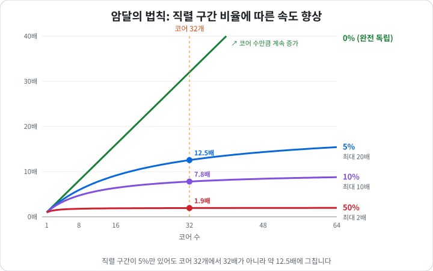
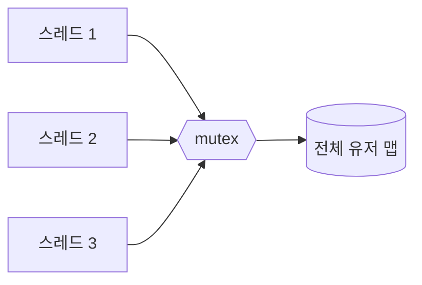
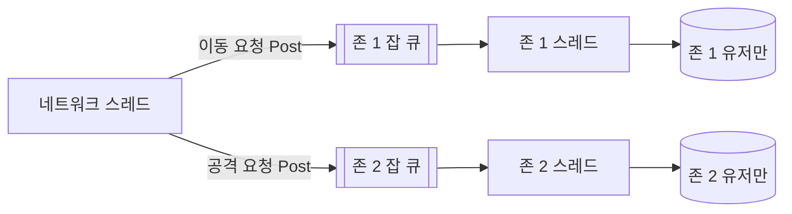

# 멀티스레드를 쓰는 이유
> 📌 연관 기출: [NC Project NL Q5](../Interview/NC_Project_NL_%EB%A9%B4%EC%A0%91_%EC%A7%88%EB%AC%B8.md) - "스레드를 늘려도 빨라지지 않는데 왜 멀티스레드를 쓰나?" 꼬리 질문 대비

- **한 줄 결론**: 스레드를 늘려도 안 빨라지는 건 **모두가 같은 데이터에 쓸 때** 의 이야기입니다. 멀티스레드가 느린 게 아니라 **공유하는 데이터가 병목** 이 되는 것이고, 그래서 멀티스레드 설계의 핵심은 **공유를 줄이는 것** 입니다.

---

## 1. 비유로 이해하기
- 직원 32명이 **노트 한 권** 에 번갈아 쓰면 → 안 빨라짐 ([Atomic과_캐시_일관성](./Atomic%EA%B3%BC_%EC%BA%90%EC%8B%9C_%EC%9D%BC%EA%B4%80%EC%84%B1.md)의 상황)
- 직원 32명이 **각자 다른 서류** 를 처리하면 → 32배 가까이 빨라짐 (멀티스레드를 쓰는 진짜 이유)

---

## 2. 멀티스레드를 쓰는 이유 3가지
### 1) 독립적인 일을 동시에 처리 (병렬 처리)
- 유저 A의 이동, 유저 B의 전투, 유저 C의 아이템 사용이 서로 상관없다면 각 코어가 따로 처리할 수 있습니다.
- 코어가 32개인데 스레드를 하나만 쓰면 **31개 코어가 놀게** 됩니다.

### 2) 기다리는 시간 동안 다른 일 하기 (I/O 대기 숨기기)
- 게임 서버에는 기다리는 일이 많습니다: DB 쿼리 응답, 네트워크 패킷 수신, 파일 저장
- 스레드가 하나면 DB 응답을 기다리는 동안(수 ms) **서버 전체가 멈춥니다.**
- 그래서 IOCP 워커 스레드, DB 전용 스레드처럼 **기다리는 일을 분리** 합니다.

### 3) 무거운 작업 때문에 메인 흐름이 멈추지 않게 (응답성)
- 로그 기록, 길찾기 계산, 대량 저장 같은 무거운 작업을 별도 스레드로 빼서 게임 로직 루프가 끊기지 않게 합니다.

|이유|핵심|게임 서버 예시|
|---|---|---|
|병렬 처리|코어를 놀리지 않음|존/채널별 로직 처리|
|I/O 대기 숨기기|기다리는 동안 다른 일|IOCP 워커, DB 스레드|
|응답성|무거운 일 분리|로그 스레드, 길찾기 잡|

---

## 3. 얼마나 빨라질 수 있나: 암달의 법칙 (Amdahl's Law)
- 전체 작업 중 **한 줄로만 처리되는 부분 (공유 부분, 직렬 구간)** 의 비율이 속도의 상한을 정한다는 법칙입니다.

```math
\text{Speedup} = \frac{1}{S + \frac{1 - S}{N}}
```
- `S`: 한 줄로만 처리되는 비율, `N`: 코어 수
- `N`을 무한히 늘려도 최대 속도는 `1 / S`를 넘을 수 없습니다.

|한 줄로만 처리되는 비율 (S)|코어 32개일 때|코어를 무한히 늘렸을 때|
|---|---|---|
|0% (완전히 독립)|32배|코어 수만큼|
|5%|약 12.5배|최대 20배|
|10%|약 7.8배|최대 10배|
|50%|약 1.9배|최대 2배|
|100% (atomic 카운터 예시)|1배|1배, 실제로는 핑퐁 때문에 오히려 느려짐|



- atomic 카운터 예시는 **모든 작업이 공유 부분** 인 극단적인 경우라 안 빨라졌던 것입니다.
- 공유 부분이 **5%만 있어도** 코어 32개의 이점이 절반 이하로 줄어듭니다. 그만큼 공유를 줄이는 게 중요합니다.

---

## 4. 멀티스레드가 오히려 느려지는 경우
|원인|설명|관련 문서|
|---|---|---|
|공유 데이터 쓰기|캐시라인 핑퐁|[MESI_프로토콜](./MESI_%ED%94%84%EB%A1%9C%ED%86%A0%EC%BD%9C.md)|
|False Sharing|다른 변수인데 같은 캐시라인|[메모리_얼라인먼트](./%EB%A9%94%EB%AA%A8%EB%A6%AC_%EC%96%BC%EB%9D%BC%EC%9D%B8%EB%A8%BC%ED%8A%B8.md)|
|락 경합|대기 + Context Switching|[Context_Switching](./Context_Switching.md)|
|힙 할당 경합|new/delete가 힙 락을 두고 경쟁|[멀티스레드_메모리_할당](./%EB%A9%80%ED%8B%B0%EC%8A%A4%EB%A0%88%EB%93%9C_%EB%A9%94%EB%AA%A8%EB%A6%AC_%ED%95%A0%EB%8B%B9.md)|
|스레드가 코어보다 많음|잦은 Context Switching, 캐시 오염|[Context_Switching](./Context_Switching.md)|

---

## 5. 설계의 핵심: 공유를 줄여라
1. **데이터 나누기 (Partitioning)**
    - 존/채널/방 단위로 스레드를 나눠, 각 스레드가 **자기 데이터만** 만지게 합니다.
2. **소유자 정하기 (Ownership)**
    - 유저 하나의 처리는 항상 한 스레드(또는 하나의 잡 큐)가 맡게 해서 **락이 필요 없게** 합니다.
3. **메시지로 주고받기 (Message Passing)**
    - 다른 스레드의 데이터를 직접 고치지 않고, 큐에 "이거 해줘"를 넣습니다.
4. **읽기는 공유, 쓰기는 분리**
    - 기획 데이터처럼 읽기만 하는 건 같이 보고, 자주 바뀌는 건 스레드별로 둡니다.
    - MESI에서 S(공유 읽기)는 빠르고 M 핑퐁(공유 쓰기)은 느린 것과 같은 이유입니다.
5. **꼭 공유해야 하는 값은 따로 모았다가 합치기**
    - 스레드별 카운터처럼 각자 모으고 가끔 합칩니다.

**나쁜 예: 공유 데이터 + 락**


**좋은 예: 존별 소유 + 잡 큐**

- 나쁜 예는 모든 스레드가 락 하나에 줄을 서고, 좋은 예는 **각 존이 자기 데이터만 만져서 락이 없습니다.**

```cpp
// 나쁜 예: 모든 스레드가 공유 맵 하나를 락 걸고 수정
std::mutex g_mtx;
std::unordered_map<UserId, User> g_users;

// 좋은 예: 존마다 자기 유저만 소유, 다른 존에는 메시지로 요청
class Zone {
    std::unordered_map<UserId, User> users_;   // 이 존의 스레드만 접근
    JobQueue jobs_;                            // 다른 스레드는 여기에 작업만 넣음
public:
    void Post(Job job) { jobs_.Push(std::move(job)); }
    void Update() { jobs_.ExecuteAll(); /* 락 없이 users_ 처리 */ }
};
```

---

## 6. 면접 답변
> "멀티스레드는 독립적인 작업을 여러 코어에서 동시에 처리하고, I/O를 기다리는 동안 다른 일을 하기 위해 씁니다. 다만 암달의 법칙처럼 공유 자원에 대한 직렬 구간이 성능 상한을 정하기 때문에, 같은 데이터를 여러 스레드가 쓰면 오히려 느려질 수 있습니다. 그래서 게임 서버에서는 데이터를 존이나 유저 단위로 나눠 소유권을 정하고, 공유가 필요한 부분은 최소화하는 방향으로 설계합니다."

- 관련 문서: [Atomic과_캐시_일관성](./Atomic%EA%B3%BC_%EC%BA%90%EC%8B%9C_%EC%9D%BC%EA%B4%80%EC%84%B1.md), [MESI_프로토콜](./MESI_%ED%94%84%EB%A1%9C%ED%86%A0%EC%BD%9C.md), [Context_Switching](./Context_Switching.md), [멀티스레드_메모리_할당](./%EB%A9%80%ED%8B%B0%EC%8A%A4%EB%A0%88%EB%93%9C_%EB%A9%94%EB%AA%A8%EB%A6%AC_%ED%95%A0%EB%8B%B9.md)
